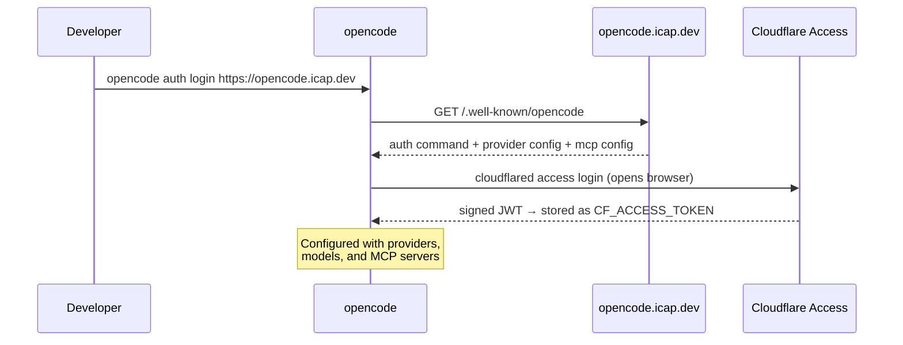
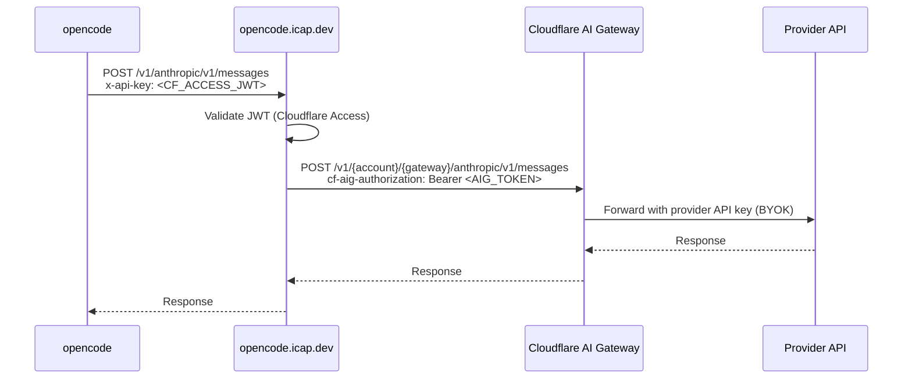
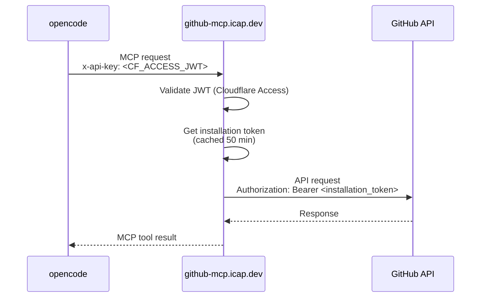
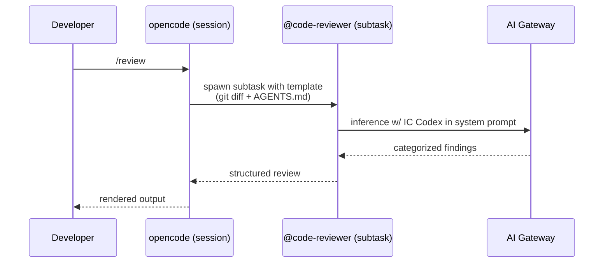

# OpenCode Proxy

A pair of Cloudflare Workers that give developers at [Initial Capacity](https://initialcapacity.io)
zero-config access to AI models, GitHub tooling, and a shared code-review agent through
[OpenCode](https://opencode.ai/), authenticated via Cloudflare Access SSO.

## Set up

1. Install dependencies

    ```shell
    brew install anomalyco/tap/opencode cloudflared
    ```

2. Authenticate

    ```shell
    opencode auth login https://opencode.icap.dev
    ```

    This opens your browser for SSO. After authenticating, OpenCode automatically configures itself
    with providers, models, and the GitHub MCP server — no manual config required.

3. Run OpenCode

    ```shell
    opencode
    ```

## Reviewing code

Every session ships with a `@code-reviewer` subagent and a `/review` slash command. The
reviewer knows the [IC Codex](#ic-codex) — Initial Capacity's engineering principles codified
as ~40 machine-readable rules — and cites specific rule IDs when flagging findings.

Run it on the current branch's diff against `origin/main`:

```
/review
```

Or invoke the agent directly with your own context:

```
@code-reviewer review the changes I just staged
```

The reviewer is a subagent — it runs in an isolated child session and posts categorized
findings (Architecture, Code quality, Testing) with severity tags (`critical`, `important`,
`suggestion`, `nit`) and rule citations like `IC-TEST-009`. The reviewer's scope is
strictly the Codex: it only flags violations of a specific IC rule and says nothing about
concerns the Codex doesn't cover. See [Code review agent](#code-review-agent) below for
the internals.

## Architecture

Two Workers are deployed:

| Worker | Domain | Purpose |
|--------|--------|---------|
| `opencode-proxy` | `opencode.icap.dev` | AI model proxy, discovery endpoint, Codex endpoint, agent + command config |
| `github-mcp` | `github-mcp.icap.dev` | GitHub MCP server |

### Discovery and authentication

When a developer runs `opencode auth login`, OpenCode fetches
`https://opencode.icap.dev/.well-known/opencode`. This single endpoint returns everything OpenCode
needs: how to authenticate, which providers to use, and which MCP servers to connect to.



### AI model proxy

All model requests are routed through the `opencode-proxy` worker, which validates the Cloudflare
Access JWT and forwards to [AI Gateway](https://developers.cloudflare.com/ai-gateway/). Provider API
keys are stored in AI Gateway (BYOK) — they never touch developer machines.



Three providers are available:

| OpenCode provider | Gateway path | SDK |
|---|---|---|
| `ic-anthropic` | `anthropic` | `@ai-sdk/anthropic` |
| `ic-openai` | `openai` | `@ai-sdk/openai` |
| `ic-workers-ai` | `compat` | `@ai-sdk/openai-compatible` |

Models are fetched from [models.dev](https://models.dev) hourly by a cron trigger and cached in
Workers KV. The discovery endpoint includes the full model catalog so OpenCode can populate the
model picker without any external calls.

### GitHub MCP server

The `github-mcp` worker exposes a remote [MCP](https://modelcontextprotocol.io/) server at
`https://github-mcp.icap.dev/mcp`. It is advertised via the discovery endpoint and picked up
automatically when a developer logs in.

Authentication uses the same Cloudflare Access JWT passed as `x-api-key`. GitHub API calls are made
with a server-side installation token from a GitHub App — no personal tokens, no credentials on
developer machines.



Available tools:

| Tool | Description |
|------|-------------|
| `list_repos` | List repositories in the org, sorted by most recently updated. Paginated — use page and per_page to navigate results. |
| `search_code` | Search code across repositories in the organization |
| `get_file_content` | Get the content of a file from a repository |
| `list_issues` | List issues for a repository |
| `get_issue` | Get details of a specific issue including comments |
| `list_pull_requests` | List pull requests for a repository |
| `get_pull_request` | Get details of a specific pull request including the diff |

### IC Codex

The IC Codex is the machine-readable form of [kt.dev](https://kt.dev) — Initial Capacity's
opinionated engineering principles — split into ~40 rules with stable IDs. Each rule lives
in its own markdown file under `codex/rules/` with frontmatter declaring its `id`,
`category` (`architecture`, `code`, `testing`), and `severity_default`. The full corpus is
published at `https://opencode.icap.dev/.well-known/codex` as JSON.

```
curl -s https://opencode.icap.dev/.well-known/codex | jq '.rules[] | {id, title, severity}'
```

Rules are compiled at build time from `codex/rules/*.md` into `src/codex.generated.ts` by
`scripts/build-codex.mjs`. See `codex/README.md` for the authoring format.

### Code review agent

Every OpenCode session at IC picks up a `code-reviewer` subagent and a `/review` slash
command via the discovery payload. The agent's system prompt is compiled at build time
from `agents/code-reviewer.md` with the full IC Codex inlined as an appendix, so the
reviewer always has the current rule corpus in context.



The reviewer runs as a subagent (read-only, `edit: deny`, `webfetch: allow`) and produces
findings grouped by Codex category — Architecture, Code quality, Testing — with severity
tags and rule citations. Every finding must map to a specific `IC-*` rule; concerns the
Codex doesn't cover are intentionally out of scope. This keeps the reviewer predictable:
as the Codex grows, so does the scope of the review.

Source files:

| Path | Purpose |
|------|---------|
| `agents/code-reviewer.md` | Agent frontmatter + system prompt |
| `commands/review.md` | `/review` slash command template |
| `scripts/build-agents.mjs` | Compiles both into `src/agents.generated.ts`, inlining the Codex into the agent prompt |

The compiled agent and command are served in the `config.agent` and `config.command`
blocks of the discovery payload, so every developer gets them automatically on next
session — no local configuration.

## Project structure

```
opencode-proxy/
├── src/                        # opencode-proxy worker
│   ├── index.ts                # Routes, scheduled handler
│   ├── discovery.ts            # .well-known/opencode payload
│   ├── models.ts               # Model catalog (KV cache)
│   ├── gateway.ts              # AI Gateway proxy
│   ├── auth.ts                 # JWT middleware + extractToken
│   ├── jwt.ts                  # Cloudflare Access JWT verification
│   ├── logging.ts              # Request logging middleware
│   ├── codex.ts                # IC Codex catalog (DI wrapper)
│   ├── agents.ts               # Compiled agents + commands (DI wrapper)
│   └── landing.ts              # HTML landing page
├── codex/                      # IC Codex source
│   ├── README.md               # Rule authoring format
│   └── rules/                  # One markdown file per rule
├── agents/                     # OpenCode agent definitions (markdown)
│   └── code-reviewer.md
├── commands/                   # OpenCode slash command definitions (markdown)
│   └── review.md
├── scripts/                    # Build scripts (Node ESM)
│   ├── build-codex.mjs         # codex/rules/ → src/codex.generated.ts
│   ├── build-agents.mjs        # agents/ + commands/ → src/agents.generated.ts
│   └── lib/frontmatter.mjs     # Shared YAML frontmatter parser
├── github-mcp/                 # github-mcp worker
│   ├── index.ts                # Worker entry point + auth
│   ├── tools.ts                # MCP tool definitions
│   └── github-app.ts           # GitHub App installation token (cached)
├── test/                       # Test suite (vitest + Workers pool)
├── wrangler.jsonc              # opencode-proxy config
└── wrangler.github-mcp.jsonc   # github-mcp config
```

## Development

```shell
npm test                  # run all tests
npm run typecheck         # typecheck all projects
npm run dev               # opencode-proxy local dev
npm run dev:github-mcp    # github-mcp local dev
npm run build:config      # regenerate codex + agents (runs automatically on pre-hooks)
```

Editing Codex rules, the agent prompt, or the `/review` command means editing markdown
files:

- Add or change a rule: `codex/rules/IC-<CATEGORY>-<NNN>.md` (see `codex/README.md`).
- Change the reviewer's behavior: `agents/code-reviewer.md`.
- Change the `/review` template: `commands/review.md`.

The pre-hooks on `npm test`, `npm run typecheck`, `npm run deploy`, and `npm run dev`
regenerate `src/codex.generated.ts` and `src/agents.generated.ts` automatically, so you
never need to run the build script by hand.

Deployments are handled by the CI/CD pipeline on push to `main`. Do not run `npm run deploy`
locally.
