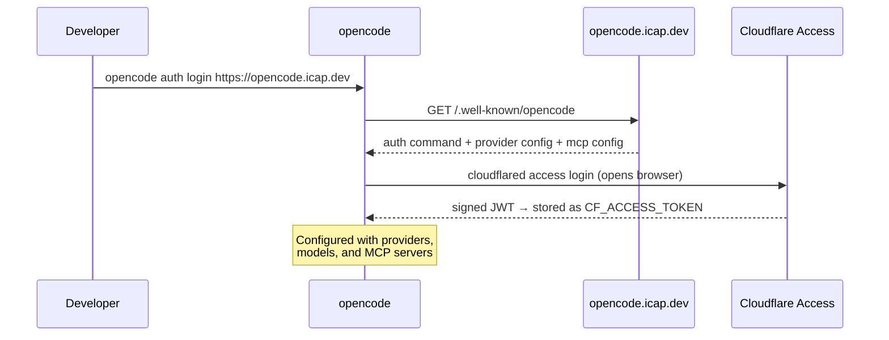
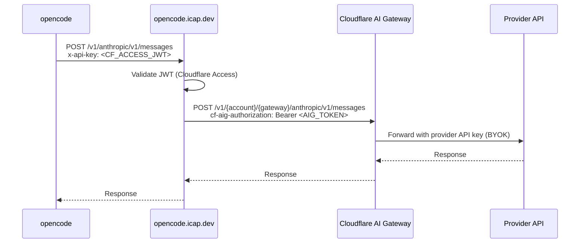
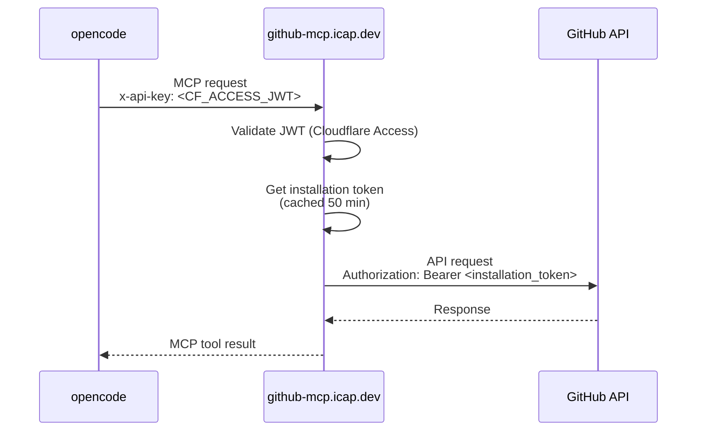

# OpenCode Proxy

A pair of Cloudflare Workers that give developers at [Initial Capacity](https://initialcapacity.io)
zero-config access to AI models and GitHub tooling through [OpenCode](https://opencode.ai/),
authenticated via Cloudflare Access SSO.

## Set up

1. Install dependencies

    ```shell
    brew install anomalyco/tap/opencode cloudflared
    ```

2. Authenticate

    ```shell
    opencode auth login https://opencode.icap.dev
    ```

    This opens your browser for SSO. After authenticating, OpenCode automatically configures itself
    with providers, models, and the GitHub MCP server — no manual config required.

3. Run OpenCode

    ```shell
    opencode
    ```

## Architecture

Two Workers are deployed:

| Worker | Domain | Purpose |
|--------|--------|---------|
| `opencode-proxy` | `opencode.icap.dev` | AI model proxy + discovery endpoint |
| `github-mcp` | `github-mcp.icap.dev` | GitHub MCP server |

### Discovery and authentication

When a developer runs `opencode auth login`, OpenCode fetches
`https://opencode.icap.dev/.well-known/opencode`. This single endpoint returns everything OpenCode
needs: how to authenticate, which providers to use, and which MCP servers to connect to.



### AI model proxy

All model requests are routed through the `opencode-proxy` worker, which validates the Cloudflare
Access JWT and forwards to [AI Gateway](https://developers.cloudflare.com/ai-gateway/). Provider API
keys are stored in AI Gateway (BYOK) — they never touch developer machines.



Three providers are available:

| OpenCode provider | Gateway path | SDK |
|---|---|---|
| `ic-anthropic` | `anthropic` | `@ai-sdk/anthropic` |
| `ic-openai` | `openai` | `@ai-sdk/openai` |
| `ic-workers-ai` | `compat` | `@ai-sdk/openai-compatible` |

Models are fetched from [models.dev](https://models.dev) hourly by a cron trigger and cached in
Workers KV. The discovery endpoint includes the full model catalog so OpenCode can populate the
model picker without any external calls.

### GitHub MCP server

The `github-mcp` worker exposes a remote [MCP](https://modelcontextprotocol.io/) server at
`https://github-mcp.icap.dev/mcp`. It is advertised via the discovery endpoint and picked up
automatically when a developer logs in.

Authentication uses the same Cloudflare Access JWT passed as `x-api-key`. GitHub API calls are made
with a server-side installation token from a GitHub App — no personal tokens, no credentials on
developer machines.



Available tools:

| Tool | Description |
|------|-------------|
| `list_repos` | List repositories in the org, sorted by most recently updated. Paginated — use page and per_page to navigate results. |
| `search_code` | Search code across repositories in the organization |
| `get_file_content` | Get the content of a file from a repository |
| `list_issues` | List issues for a repository |
| `get_issue` | Get details of a specific issue including comments |
| `list_pull_requests` | List pull requests for a repository |
| `get_pull_request` | Get details of a specific pull request including the diff |

## Project structure

```
opencode-proxy/
├── src/                        # opencode-proxy worker
│   ├── index.ts                # Routes, scheduled handler
│   ├── discovery.ts            # .well-known/opencode payload
│   ├── models.ts               # Model catalog (KV cache)
│   ├── gateway.ts              # AI Gateway proxy
│   ├── auth.ts                 # JWT middleware + extractToken
│   ├── jwt.ts                  # Cloudflare Access JWT verification
│   ├── logging.ts              # Request logging middleware
│   └── landing.ts              # HTML landing page
├── github-mcp/                 # github-mcp worker
│   ├── index.ts                # Worker entry point + auth
│   ├── tools.ts                # MCP tool definitions
│   └── github-app.ts           # GitHub App installation token (cached)
├── test/                       # Test suite (vitest + Workers pool)
├── wrangler.jsonc              # opencode-proxy config
└── wrangler.github-mcp.jsonc   # github-mcp config
```

## Development

```shell
npm test                  # run all tests
npm run typecheck         # typecheck all projects
npm run dev               # opencode-proxy local dev
npm run dev:github-mcp    # github-mcp local dev
```

Deployments are handled by the CI/CD pipeline on push to `main`. Do not run `npm run deploy`
locally.
