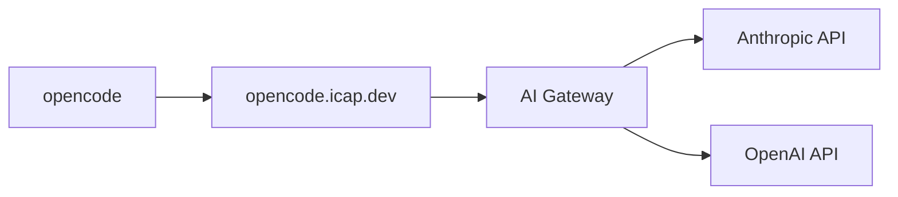

# OpenCode Proxy

A Cloudflare Worker provides [OpenCode](https://opencode.ai/) access to AI models through a centralized [AI Gateway](https://developers.cloudflare.com/ai-gateway/),
authenticated via Cloudflare Access SSO.

## Set up

1.  Install dependencies

    ```shell
    brew install anomalyco/tap/opencode cloudflared
    ```

1.  Authenticate

    ```sh
    opencode auth login https://opencode.icap.dev
    ```

    This opens your browser for SSO. After authenticating, opencode automatically configures itself to
    route Anthropic and OpenAI requests through the company proxy.

1.  Run opencode

    ```sh
    opencode
    ```

    Select an Anthropic or OpenAI model and start a session. All requests are routed through the AI Gateway.

## How it works



1. `opencode auth login` runs `cloudflared access login` to authenticate via SSO, storing a
   Cloudflare Access JWT locally.
2. The proxy's `/.well-known/opencode` endpoint tells opencode to use the proxy as the base URL for
   each provider, with the JWT as the API key.
3. On each request, the worker validates the JWT, strips it, and forwards to AI Gateway with a
   `cf-aig-authorization` header. Provider API keys are stored in the gateway (BYOK), not in the
   worker or on developer machines.
